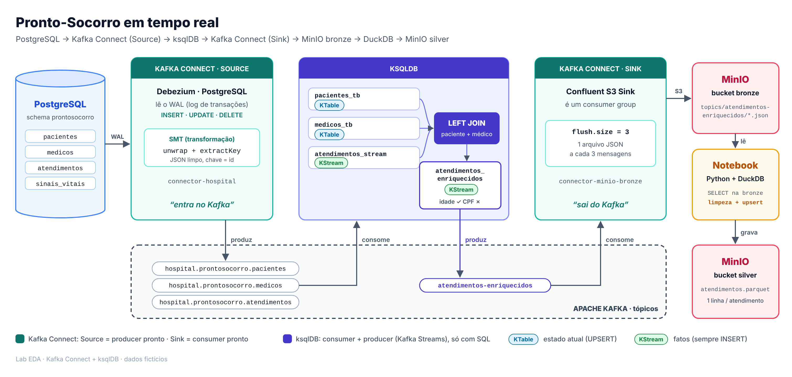

# Lab EDA - Kafka Connect + ksqlDB: Pronto-Socorro em Tempo Real

---
## Disclaimer
> **As configurações dos Laboratórios é puramente para fins de desenvolvimento local e estudos**
>
> **Todos os dados de pacientes deste lab são fictícios.**

## Pré-requisitos
* Docker
* Docker Compose
* Ter visto os labs [Kafka](../../21.Ingestao-Dados-Kafka/README.md), [Kafka Connect](../../21.Ingestao-Dados-Kafka-Connect/README.md) e [ksqlDB](../ksqldb/README.md). Nesta aula juntamos os três em um único caso de uso.

---

## O caso de uso

O **pronto-socorro** de um hospital registra tudo em um PostgreSQL:

| Tabela | O que guarda |
|---|---|
| `pacientes` | Cadastro: nome, CPF, data de nascimento, convênio |
| `medicos` | Cadastro: nome, CRM, especialidade |
| `atendimentos` | Cada entrada no PS: paciente, médico, **classificação de risco** e status (`AGUARDANDO`, `EM_ATENDIMENTO`, `ALTA`) |
| `sinais_vitais` | Leituras dos monitores: frequência cardíaca, saturação de oxigênio (SpO2) e temperatura |

A **classificação de risco** segue o Protocolo:

| Cor | Prioridade |
|---|---|
| 🔴 `VERMELHO` | Emergência: atendimento imediato |
| 🟠 `LARANJA` | Muito urgente |
| 🟡 `AMARELO` | Urgente |
| 🟢 `VERDE` | Pouco urgente |
| 🔵 `AZUL` | Não urgente |

A coordenação do PS quer:

1. Ver cada **atendimento novo em tempo real**, já com **nome e idade do paciente**, **médico** e **especialidade** (e não só os IDs).
2. Gravar esses atendimentos enriquecidos no **Data Lake** (MinIO).
3. Consultar o Data Lake com **SQL em Python** (DuckDB) para análises.

**Regra do exercício:** ninguém vai escrever producer, consumer ou aplicação Java. Só **configuração (Kafka Connect)**, **SQL (ksqlDB)** e, no final, um notebook simples para consultar o resultado.



---

## Subindo o ambiente

### A pasta da aula

Esta aula tem o **próprio `docker-compose.yaml`**, montado a partir do compose do curso, só com os serviços do caso de uso:

> [!IMPORTANT]
> Todos os comandos `docker compose` desta aula são executados **dentro desta pasta**.
>
> Os nomes dos containers são os mesmos do compose do curso (`kafka-broker`, `kafkaConect2`, `postgres`...). Se o ambiente do curso estiver rodando, derrube antes (na raiz do repositório: `docker compose down`), senão dá conflito de nome e de porta.

Dois detalhes que importam para a aula:

* O serviço `connect` monta a pasta `./15.EDA-Event-Driven-Architecture/caso-uso/conectores` em `/conectores`. **Todo JSON de conector que você colocar nessa pasta fica visível dentro do container do Connect.**
* O Connect usa `JsonConverter` com `schemas.enable=false`: as mensagens chegam no Kafka como **JSON puro**, que é exatamente o formato que o ksqlDB vai ler com `VALUE_FORMAT='JSON'`.

### Subindo

```sh
docker compose up -d zookeeper kafka-broker connectksqldb akhq2 postgres pgadmin minio ksqldb-server ksqldb-cli  python-lab

docker container ls
```

| Serviço | Papel na aula | Acesso |
|---|---|---|
| `zookeeper` / `kafka-broker` | Cluster Kafka | `localhost:9092` |
| `connect` (container `kafkaConect2`) | Kafka Connect: move dados para dentro e para fora do Kafka | API REST: http://localhost:8083 |
| `postgres` | Banco do hospital, já com o schema `prontosocorro` | `localhost:5432` |
| `pgadmin` | Interface do PostgreSQL | http://localhost:5433 (`lab-pgadmin4@pgadmin.org` / `postgres`) |
| `ksqldb-server` / `ksqldb-cli` | Processamento de streams com SQL | http://localhost:8088 |
| `minio` | Data Lake S3 | http://localhost:9001 (`admin` / `minioadmin`) |
| `akhq` | Interface do Kafka e do Connect | http://localhost:8080/ui |
| `notebook` | Jupyter Lab com DuckDB | http://localhost:8890 |

### Organização dos terminais

Durante a aula vamos usar **3 terminais**, cada um "dentro" de um container. Sempre que um passo pedir um deles, o comando para entrar estará no próprio passo:

| Terminal | Para que serve | Como entrar |
|---|---|---|
| **Terminal do Connect** | Criar e gerenciar conectores (API REST) | `docker exec -it kafkaConect2 bash` |
| **Terminal do Kafka** | Listar tópicos, consumir mensagens | `docker exec -it kafka-broker bash` |
| **Terminal do ksqlDB** | Escrever SQL de streaming | `docker compose exec ksqldb-cli ksql http://ksqldb-server:8088` |

E o **pgAdmin** aberto no navegador para fazer `INSERT`/`UPDATE`/`DELETE` no banco.

---

## Kafka Connect, do zero

### O problema que o Connect resolve

Imagine que o Kafka **não tivesse** o Connect. Para levar cada novo atendimento do PS para o Kafka, você teria que escrever uma aplicação que:

1. Conecta no banco
2. Descobre o que mudou desde a última leitura (como? `SELECT` por data? e os registros apagados? e o status que mudou 3 vezes entre duas leituras?)
3. Converte cada linha para JSON
4. Usa um **producer** para mandar para o Kafka
5. Guarda em algum lugar **até onde já leu**, para não perder nem duplicar nada se cair
6. Trata erro, reconexão, escala...

E depois outra aplicação, com um **consumer**, para tirar do Kafka e gravar no Data Lake.

**O Kafka Connect é esse código já escrito, testado e genérico.** Você só diz *de onde* e *para onde* em um arquivo JSON.

| Sem Connect | Com Connect |
|---|---|
| Você escreve um producer | Um **Source Connector** já é o producer |
| Você escreve um consumer | Um **Sink Connector** já é o consumer |
| Você guarda o offset/posição | O Connect guarda no tópico `connect-offsets` |
| Você faz deploy da aplicação | Você faz um `PUT` de um JSON na API REST |
| Você trata falhas e reinício | O Connect reinicia a *task* e continua de onde parou |

### As peças, com uma analogia

Pense no Connect como uma **tomada universal** do Kafka:

| Peça | Analogia | No nosso lab |
|---|---|---|
| **Worker** | A tomada na parede: o processo que fica rodando | Container `kafkaConect2`, porta `8083` |
| **Plugin** | O adaptador para cada tipo de aparelho (um `.jar`) | Debezium PostgreSQL e Confluent S3 Sink, já instalados na imagem |
| **Connector** | O aparelho ligado na tomada, com sua configuração | `connector-hospital`, `connector-minio-bronze` |
| **Task** | Quem realmente trabalha (uma *thread*) | `tasks.max: 1` |
| **Converter** | O idioma em que o dado é escrito no Kafka | `JsonConverter` (JSON puro) |
| **Transform (SMT)** | Um pequeno ajuste em cada mensagem no caminho | Vamos usar na Parte 3 para "limpar" o JSON do Debezium |


###  Conversando com o Connect pela API REST

O Connect **não tem tela própria**. Tudo é feito por HTTP na porta `8083` (o AKHQ é só uma interface por cima dessa API).

| O que fazer | Método e endpoint |
|---|---|
| Listar plugins instalados | `GET /connector-plugins` |
| Listar conectores | `GET /connectors` |
| Criar ou atualizar | `PUT /connectors/<nome>/config` |
| Ver o status | `GET /connectors/<nome>/status` |
| Pausar / retomar | `PUT /connectors/<nome>/pause` e `/resume` |
| Reiniciar (com as tasks) | `POST /connectors/<nome>/restart?includeTasks=true` |
| Apagar | `DELETE /connectors/<nome>` |

Entre no container do Kafka Connect:

```sh
docker exec -it kafkaConect2 bash
```

Dentro do container, veja quais "adaptadores" temos instalados:

```sh
curl -s http://localhost:8083/connector-plugins
```

Procure na resposta:

```
io.debezium.connector.postgresql.PostgresConnector   (source)
io.confluent.connect.s3.S3SinkConnector              (sink)
```

> Se der `Connection refused`, o Connect ainda está subindo. Espere alguns segundos.

> 💡 O valor `class` que aparece aqui é **exatamente** o que vai no campo `connector.class` dos JSONs. Sem o plugin na lista, o conector não é criado.

Conectores criados até agora (ainda nenhum):

```sh
curl -s http://localhost:8083/connectors
```

Veja também que os arquivos da pasta `conectores` da aula estão dentro do container:

```sh
ls /conectores
```

Deixe esse terminal aberto: vamos usá-lo para criar os conectores.

### O banco do pronto-socorro

Acesse o pgAdmin em http://localhost:5433

* Login: `lab-pgadmin4@pgadmin.org`
* Senha: `postgres`


O banco **já subiu pronto**: o compose monta `sql/hospital.sql` em `/docker-entrypoint-initdb.d/`, e o PostgreSQL executa os scripts dessa pasta na primeira vez que o container é criado.

| Campo | Valor |
|---|---|
| Name (aba General) | `postgres` |
| Host name/address (aba Connection) | `postgres` |
| Maintenance database | `postgres` |
| Username | `postgres` |
| Password | `postgres` |

No pgAdmin (http://localhost:5433, login `lab-pgadmin4@pgadmin.org` / senha `postgres`), o server **`postgres-hospital`** já está na lista. Clique nele e informe a senha `postgres`.

Este é o script que foi executado (vale ler com a turma: é o "sistema do hospital" que vamos integrar):

```sql
CREATE SCHEMA IF NOT EXISTS prontosocorro;

-- Cadastro de pacientes
CREATE TABLE prontosocorro.pacientes (
    id              SERIAL PRIMARY KEY,
    nome            VARCHAR(100) NOT NULL,
    cpf             VARCHAR(14)  NOT NULL,
    data_nascimento DATE         NOT NULL,
    convenio        VARCHAR(50)  NOT NULL
);

-- Cadastro de médicos
CREATE TABLE prontosocorro.medicos (
    id            SERIAL PRIMARY KEY,
    nome          VARCHAR(100) NOT NULL,
    crm           VARCHAR(20)  NOT NULL,
    especialidade VARCHAR(50)  NOT NULL
);

-- Atendimentos do pronto-socorro (classificação de risco: Protocolo de Manchester)
CREATE TABLE prontosocorro.atendimentos (
    id                  SERIAL PRIMARY KEY,
    paciente_id         INT          NOT NULL REFERENCES prontosocorro.pacientes(id),
    medico_id           INT          NOT NULL REFERENCES prontosocorro.medicos(id),
    classificacao_risco VARCHAR(10)  NOT NULL
        CHECK (classificacao_risco IN ('VERMELHO','LARANJA','AMARELO','VERDE','AZUL')),
    queixa              VARCHAR(200),
    status              VARCHAR(20)  NOT NULL DEFAULT 'AGUARDANDO'
        CHECK (status IN ('AGUARDANDO','EM_ATENDIMENTO','ALTA')),
    aberto_em           TIMESTAMPTZ  NOT NULL DEFAULT now()
);

-- Leituras dos monitores de sinais vitais
CREATE TABLE prontosocorro.sinais_vitais (
    id                  SERIAL PRIMARY KEY,
    paciente_id         INT              NOT NULL REFERENCES prontosocorro.pacientes(id),
    frequencia_cardiaca INT              NOT NULL,   -- batimentos por minuto
    saturacao           INT              NOT NULL,   -- SpO2 em %
    temperatura         DOUBLE PRECISION NOT NULL,   -- graus Celsius
    registrado_em       TIMESTAMPTZ      NOT NULL DEFAULT now()
);

-- Grava a linha "antiga" completa no WAL: o campo "before" do Debezium vem preenchido no UPDATE/DELETE
ALTER TABLE prontosocorro.pacientes     REPLICA IDENTITY FULL;
ALTER TABLE prontosocorro.medicos       REPLICA IDENTITY FULL;
ALTER TABLE prontosocorro.atendimentos  REPLICA IDENTITY FULL;
ALTER TABLE prontosocorro.sinais_vitais REPLICA IDENTITY FULL;

-- Dados iniciais
INSERT INTO prontosocorro.pacientes (nome, cpf, data_nascimento, convenio) VALUES
  ('Maria Silva',    '111.111.111-11', '1958-03-12', 'SUS'),
  ('Joao Santos',    '222.222.222-22', '1990-07-25', 'Unimed'),
  ('Ana Oliveira',   '333.333.333-33', '1975-11-02', 'Bradesco Saude'),
  ('Carlos Souza',   '444.444.444-44', '1983-01-30', 'SulAmerica'),
  ('Beatriz Lima',   '555.555.555-55', '2018-05-18', 'SUS');

INSERT INTO prontosocorro.medicos (nome, crm, especialidade) VALUES
  ('Dra. Fernanda Costa', 'CRM-SP 100001', 'Clinica Geral'),
  ('Dr. Ricardo Alves',   'CRM-SP 100002', 'Cardiologia'),
  ('Dra. Juliana Rocha',  'CRM-SP 100003', 'Pediatria'),
  ('Dr. Paulo Mendes',    'CRM-SP 100004', 'Ortopedia');

INSERT INTO prontosocorro.atendimentos (paciente_id, medico_id, classificacao_risco, queixa, status) VALUES
  (1, 2, 'LARANJA',  'Dor no peito',             'EM_ATENDIMENTO'),
  (2, 4, 'VERDE',    'Torcao no tornozelo',      'AGUARDANDO'),
  (3, 1, 'AMARELO',  'Febre e tosse ha 3 dias',  'AGUARDANDO');

INSERT INTO prontosocorro.sinais_vitais (paciente_id, frequencia_cardiaca, saturacao, temperatura) VALUES
  (1, 98, 95, 36.8),
  (2, 76, 98, 36.5),
  (3, 88, 96, 38.2);
```

> 💡 O script só roda quando o container é **criado**. Para recomeçar o banco do zero: `docker compose rm -sf postgres && docker compose up -d postgres`.

Abra o **Query Tool** no banco `postgres` e confira se está tudo pronto para o CDC:

```sql
SHOW wal_level;   -- precisa ser "logical"

SELECT * FROM prontosocorro.atendimentos;
```

Repare: a tabela `atendimentos` só tem **IDs**. "Atendimento 1: paciente 1, médico 2, LARANJA" não diz nada para quem está coordenando o PS. **Resolver isso em tempo real é o objetivo da aula.**

> 📌 **Por que `REPLICA IDENTITY FULL`?** Por padrão, o PostgreSQL só grava no WAL a linha **nova** de um `UPDATE`. Com `FULL`, ele grava também a linha **antiga**, e o Debezium consegue preencher o campo `before`. Custa um pouco mais de WAL; em produção, avalie tabela por tabela.

### Primeiro conector: CDC "cru"

Veja o arquivo **`conectores/connector-hospital-cdc.json`**:

```json
{
  "connector.class": "io.debezium.connector.postgresql.PostgresConnector",
  "tasks.max": "1",
  "database.hostname": "postgres",
  "database.port": "5432",
  "database.user": "postgres",
  "database.password": "postgres",
  "database.dbname": "postgres",
  "topic.prefix": "cdc",
  "slot.name": "debezium_cdc",
  "schema.include.list": "prontosocorro"
}
```

Lendo o JSON em voz alta: *"Use o plugin Debezium PostgreSQL, conecte no host `postgres`, monitore o schema `prontosocorro`, marque sua posição de leitura no slot `debezium_cdc` e crie os tópicos com o prefixo `cdc`."*

| Propriedade | Significado |
|---|---|
| `connector.class` | Qual plugin usar |
| `tasks.max` | Para CDC de PostgreSQL é sempre **1** (o WAL é lido em ordem) |
| `database.*` | Onde e como conectar no banco |
| `topic.prefix` | Prefixo dos tópicos: **`<prefixo>.<schema>.<tabela>`** |
| `slot.name` | Nome do *replication slot*: o "marcador de página" do Debezium no WAL |
| `schema.include.list` | Quais schemas monitorar |

Se você saiu do container do Connect, entre de novo:

```sh
docker exec -it kafkaConect2 bash
```

Dentro do container, crie o conector e confira o status:

```sh
curl -s -X PUT -H 'Content-Type: application/json' \
  -d @/conectores/connector-hospital-cdc.json \
  http://localhost:8083/connectors/connector-hospital-cdc/config

curl -s http://localhost:8083/connectors/connector-hospital-cdc/status
```

Esperado: `"connector":{"state":"RUNNING"}` e `"tasks":[{"id":0,"state":"RUNNING"}]`.

> 💡 O `-d @/conectores/...` lê o arquivo **de dentro do container**. Por isso os comandos `curl` são executados no container do Connect.

> 💡 Usamos `PUT .../connectors/<nome>/config` porque ele **cria ou atualiza**. Pode rodar de novo sempre que mudar o JSON.

> 💡 O Debezium **não faz `SELECT` de tempos em tempos**. Ele lê o **WAL** (o log de transações do PostgreSQL), por isso enxerga `INSERT`, `UPDATE` **e** `DELETE`, na ordem em que aconteceram, sem pesar no banco.

Agora, em **outro terminal**, entre no container do Kafka:

```sh
docker exec -it kafka-broker bash
```

O Source criou **um tópico por tabela**:

```sh
kafka-topics --bootstrap-server localhost:9092 --list | grep -E "cdc|connect"
```

```
cdc.prontosocorro.atendimentos
cdc.prontosocorro.medicos
cdc.prontosocorro.pacientes
cdc.prontosocorro.sinais_vitais
connect-configs                 <- configuração dos conectores
connect-offsets                 <- até onde cada Source leu (posição no WAL)
connect-status                  <- status de conectores e tasks
```

> 💡 O Connect guarda **o próprio estado dentro do Kafka**. Se o container for recriado, ele continua de onde parou.

Veja uma mensagem:

```sh
kafka-console-consumer --bootstrap-server localhost:9092 --topic cdc.prontosocorro.pacientes \
  --from-beginning --property print.key=true --max-messages 1
```

```json
{"id":1}    {"before":null,"after":{"id":1,"nome":"Maria Silva","cpf":"111.111.111-11","data_nascimento":-4313,"convenio":"SUS"},"source":{...},"op":"r","ts_ms":...}
 └── key              └── value: o "envelope" do Debezium
```

| `op` | Significado | `before` | `after` |
|---|---|---|---|
| `r` | *read*: snapshot inicial (linhas que já existiam) | `null` | linha |
| `c` | *create*: `INSERT` | `null` | linha nova |
| `u` | *update*: `UPDATE` | linha antiga | linha nova |
| `d` | *delete*: `DELETE` | linha apagada | `null` |

> 📌 `data_nascimento` chegou como `-4313`? O Debezium envia colunas `DATE` como **número de dias desde 01/01/1970** (negativo = antes de 1970). Vamos usar isso a nosso favor para calcular a idade no ksqlDB.

---

## ksqlDB lendo o CDC do Connect

Agora a ponte entre os dois temas: **o tópico que o Connect escreveu é a entrada do ksqlDB**.

Em um novo terminal, **na pasta da aula**, entre no ksqlDB:

```sh
docker compose exec ksqldb-cli ksql http://ksqldb-server:8088
```

Você deve ver o prompt `ksql>`. A partir daqui, os comandos são executados nesse prompt:

```sql
SET 'auto.offset.reset'='earliest';

SHOW TOPICS;

PRINT 'cdc.prontosocorro.pacientes' FROM BEGINNING LIMIT 3;
```

> 💡 O `SET 'auto.offset.reset'='earliest'` faz as consultas lerem os tópicos **desde o início**. Ele vale só para a sessão atual: se sair do ksqlDB e entrar de novo, execute outra vez.

### Um STREAM sobre o envelope do Debezium

O valor da mensagem tem objetos dentro de objetos (`before`, `after`). No ksqlDB isso é um `STRUCT`:

```sql
CREATE STREAM pacientes_cdc (
    before STRUCT<id INT, nome VARCHAR, cpf VARCHAR, data_nascimento INT, convenio VARCHAR>,
    after  STRUCT<id INT, nome VARCHAR, cpf VARCHAR, data_nascimento INT, convenio VARCHAR>,
    op     VARCHAR,
    ts_ms  BIGINT
) WITH (KAFKA_TOPIC='cdc.prontosocorro.pacientes', VALUE_FORMAT='JSON');

DESCRIBE pacientes_cdc;
```

O operador `->` acessa um campo dentro do `STRUCT`:

```sql
SELECT op,
       CASE WHEN op = 'r' THEN 'SNAPSHOT'
            WHEN op = 'c' THEN 'INSERT'
            WHEN op = 'u' THEN 'UPDATE'
            WHEN op = 'd' THEN 'DELETE'
       END               AS operacao,
       after->id         AS id,
       after->nome       AS paciente,
       before->convenio  AS convenio_antes,
       after->convenio   AS convenio_depois
FROM pacientes_cdc
EMIT CHANGES;
```

Deixe a query **rodando** e, no **pgAdmin**, execute um comando por vez:

```sql
INSERT INTO prontosocorro.pacientes (nome, cpf, data_nascimento, convenio)
VALUES ('Pedro Teste', '666.666.666-66', '2000-01-01', 'SUS');

UPDATE prontosocorro.pacientes SET convenio = 'Amil' WHERE nome = 'Pedro Teste';


```

Cada comando SQL no banco virou **uma linha nova** na query do ksqlDB, quase instantaneamente. No `UPDATE`, repare em `convenio_antes = SUS` e `convenio_depois = Amil` (graças ao `REPLICA IDENTITY FULL`).

> 💡 O `DELETE` gera uma mensagem extra com valor `null` (o *tombstone*). O STREAM simplesmente a ignora.

> 🔒 **LGPD:** repare que o **CPF** do paciente está trafegando no Kafka, em texto aberto. Dado de saúde é **dado pessoal sensível**. Vamos voltar a isso no Desafio 1.

### KStream: tudo é INSERT

Pare a query (`Ctrl + C`) e conte os eventos por tipo de operação:

```sql
SELECT op, COUNT(*) AS eventos
FROM pacientes_cdc
GROUP BY op
EMIT CHANGES;
```

Você deve ver algo como `r = 5`, `c = 1`, `u = 1`, `d = 1`.

**Pergunta para a turma:** quantos pacientes existem *agora* na tabela? E quantos eventos existem no stream?

> 💡 Esse é o conceito do **KStream**: um fluxo **imutável** de fatos. O `UPDATE` e o `DELETE` não alteram o que veio antes, eles são **mais um evento** no fim da fila. Para responder "qual é o estado atual?" precisamos de uma **KTable**, e é isso que vamos montar na Parte 4.

###  O incômodo

Trabalhar com o envelope funciona, mas dá trabalho: todo campo vira `after->campo`, a chave é um JSON `{"id":1}` e o `DELETE` precisa de tratamento especial.

**Será que o próprio Connect consegue entregar o dado já "limpo", sem escrever código?** Sim, com as **SMTs**.

---

## Connect transformando dados (SMT)

**SMT** (*Single Message Transform*) é uma transformação simples aplicada **em cada mensagem**, dentro do Connect, antes de chegar no Kafka. É configuração, não código.

Vamos criar um **segundo** conector Source, agora pensando em quem vai consumir (o ksqlDB):

| Problema | SMT que resolve |
|---|---|
| Valor com envelope `before` / `after` / `op` | `ExtractNewRecordState` (Debezium): deixa só a linha nova, "achatada" |
| Queremos saber a operação mesmo assim | `add.fields: op,source.ts_ms` adiciona os campos `__op` e `__source_ts_ms` |
| `DELETE` deve **remover** a linha na KTable | `delete.tombstone.handling.mode: tombstone`: o delete vira um *tombstone* (valor `null`) |
| Chave `{"id":1}` em vez de `1` | `ExtractField$Key` (do próprio Kafka): extrai só o campo `id` da chave |

### O arquivo do conector

Veja o arquivo **`conectores/connector-hospital.json`**:

```json
{
  "connector.class": "io.debezium.connector.postgresql.PostgresConnector",
  "tasks.max": "1",
  "database.hostname": "postgres",
  "database.port": "5432",
  "database.user": "postgres",
  "database.password": "postgres",
  "database.dbname": "postgres",
  "topic.prefix": "hospital",
  "slot.name": "debezium_hospital",
  "schema.include.list": "prontosocorro",
  "transforms": "unwrap,extractKey",
  "transforms.unwrap.type": "io.debezium.transforms.ExtractNewRecordState",
  "transforms.unwrap.add.fields": "op,source.ts_ms",
  "transforms.unwrap.delete.tombstone.handling.mode": "tombstone",
  "transforms.extractKey.type": "org.apache.kafka.connect.transforms.ExtractField$Key",
  "transforms.extractKey.field": "id"
}
```

| Propriedade nova | Por quê |
|---|---|
| `topic.prefix: hospital` | Tópicos novos (`hospital.prontosocorro.*`), sem misturar com os da Parte 1 |
| `slot.name: debezium_hospital` | Cada conector Debezium precisa do **seu próprio replication slot**. Dois conectores no mesmo slot = erro |
| `transforms: unwrap,extractKey` | A lista de SMTs, **executadas nessa ordem** |
| `transforms.<nome>.type` | A classe de cada SMT. O `<nome>` é livre, é só um apelido |

> 💡 Todas as tabelas do schema têm a coluna `id` como chave primária. É isso que permite usar o `extractKey` no schema inteiro.

### Criando e conferindo

Entre no container do Kafka Connect (se ainda não estiver nele):

```sh
docker exec -it kafkaConect2 bash
```

Dentro do container, crie o conector:

```sh
curl -s -X PUT -H 'Content-Type: application/json' \
  -d @/conectores/connector-hospital.json \
  http://localhost:8083/connectors/connector-hospital/config

curl -s http://localhost:8083/connectors

curl -s http://localhost:8083/connectors/connector-hospital/status
```

Agora, no terminal do Kafka (`docker exec -it kafka-broker bash`), compare as duas versões da **mesma** linha:

```sh

 docker exec -it kafka-broker bash
 
# Antes (envelope)
kafka-console-consumer --bootstrap-server localhost:9092 --topic cdc.prontosocorro.atendimentos \
  --from-beginning --property print.key=true --max-messages 1

# Depois (com SMT)
kafka-console-consumer --bootstrap-server localhost:9092 --topic hospital.prontosocorro.atendimentos \
  --from-beginning --property print.key=true --max-messages 1
```

```
1    {"id":1,"paciente_id":1,"medico_id":2,"classificacao_risco":"LARANJA","queixa":"Dor no peito","status":"EM_ATENDIMENTO","aberto_em":"2026-...Z","__op":"r","__source_ts_ms":...}
```

Mesmo dado, mesmo banco, mesmo plugin. **Só mudou a configuração.**

> 📌 `aberto_em` é `TIMESTAMPTZ` no banco: o Debezium envia como **texto ISO-8601 em UTC** (o `Z` no final). Por isso vamos tratá-lo como `VARCHAR` no ksqlDB.

### Vendo pela interface (AKHQ)

Em http://localhost:8080/ui → **Connect**, você vê os dois conectores, o status das tasks, a configuração e os botões de pausar, reiniciar e excluir. São as mesmas chamadas REST que fizemos com `curl`.

Teste: **pause** o `connector-hospital` pelo AKHQ, faça um `INSERT` no pgAdmin e veja que nada chega no tópico. Agora **resume**: a mensagem chega. O Connect retomou do ponto exato onde parou no WAL, sem perder nada.

```sql
INSERT INTO prontosocorro.sinais_vitais (paciente_id, frequencia_cardiaca, saturacao, temperatura)
VALUES (2, 80, 97, 36.6);
```

> 💡 No dia a dia a interface é prática. Em produção os JSONs ficam **versionados no Git** e são aplicados via API REST por um pipeline de CI/CD.

---

##  ksqlDB: o atendimento enriquecido em tempo real

Agora temos tópicos limpos. Vamos construir a lógica de negócio.

Se você saiu do ksqlDB, entre de novo **na pasta da aula**:

```sh
docker compose exec ksqldb-cli ksql http://ksqldb-server:8088
```

E no prompt `ksql>`:

```sql
SET 'auto.offset.reset'='earliest';
```

###  KTable: o estado atual de pacientes e médicos

Pacientes e médicos são **cadastros**: interessa o valor **atual** de cada `id`. Isso é uma **TABLE**. A chave do tópico (o `id` que extraímos com SMT) vira a `PRIMARY KEY`:

```sql
CREATE TABLE pacientes_tb (
    id              INT PRIMARY KEY,
    nome            VARCHAR,
    cpf             VARCHAR,
    data_nascimento INT,
    convenio        VARCHAR
) WITH (KAFKA_TOPIC='hospital.prontosocorro.pacientes', KEY_FORMAT='JSON', VALUE_FORMAT='JSON');

CREATE TABLE medicos_tb (
    id            INT PRIMARY KEY,
    nome          VARCHAR,
    crm           VARCHAR,
    especialidade VARCHAR
) WITH (KAFKA_TOPIC='hospital.prontosocorro.medicos', KEY_FORMAT='JSON', VALUE_FORMAT='JSON');

SHOW TABLES;
```

> 💡 `KEY_FORMAT='JSON'`: a chave que o Connect escreveu é o JSON `1`. Sem isso, o ksqlDB tentaria ler a chave no formato padrão `KAFKA` (binário) e o `id` viria errado.

Veja a KTable "viva":

```sql
SELECT id, nome, convenio FROM pacientes_tb EMIT CHANGES;
```

Com a query rodando, no **pgAdmin**, um comando por vez:

```sql
UPDATE prontosocorro.pacientes SET convenio = 'Unimed' WHERE id = 1;

INSERT INTO prontosocorro.pacientes (nome, cpf, data_nascimento, convenio)
VALUES ('Paciente Cadastro Errado', '000.000.000-00', '2000-01-01', 'SUS');

DELETE FROM prontosocorro.pacientes WHERE nome = 'Paciente Cadastro Errado';
```

O `UPDATE` aparece como uma **nova versão do id 1** (UPSERT). O cadastro errado aparece com o `INSERT` e, no `DELETE`, chega um *tombstone* (graças à SMT) que **remove** a linha da tabela.

> 💡 Compare com a Parte 2.2: lá, o mesmo tipo de `UPDATE` virou **mais um evento** (KStream). Aqui ele **substitui** o valor anterior (KTable). Mesmo dado de origem, duas interpretações.

> 📌 Por que não apagar um paciente que já existia, como a Maria? Ela tem atendimentos e sinais vitais (*foreign key*), e o PostgreSQL recusa o `DELETE`. Exatamente como um sistema hospitalar real deveria fazer.

###  KStream: atendimentos são fatos

Um atendimento aberto é um **acontecimento**: cada um é um evento. Isso é um **STREAM**. Pare a query anterior (`Ctrl + C`) e crie:

```sql
CREATE STREAM atendimentos_stream (
    id                  INT KEY,
    paciente_id         INT,
    medico_id           INT,
    classificacao_risco VARCHAR,
    queixa              VARCHAR,
    status              VARCHAR,
    aberto_em           VARCHAR,
    `__op`              VARCHAR,
    `__source_ts_ms`    BIGINT
) WITH (KAFKA_TOPIC='hospital.prontosocorro.atendimentos', KEY_FORMAT='JSON', VALUE_FORMAT='JSON');

SELECT id, paciente_id, medico_id, classificacao_risco, status, `__op` FROM atendimentos_stream EMIT CHANGES;
```

> 📌 Campos que começam com `_` precisam de crase (`` `__op` ``) no ksqlDB.

###  O JOIN: atendimento + paciente + médico

Pare a query (`Ctrl + C`) e teste o join (*push query*, não grava nada):

```sql
SELECT a.id                  AS atendimento_id,
       a.classificacao_risco AS risco,
       p.nome                AS paciente,
       m.nome                AS medico,
       m.especialidade       AS especialidade
FROM atendimentos_stream a
LEFT JOIN pacientes_tb p ON a.paciente_id = p.id
LEFT JOIN medicos_tb   m ON a.medico_id   = m.id
EMIT CHANGES;
```

Agora vamos **persistir** o resultado em um novo stream (e um novo tópico Kafka, `atendimentos-enriquecidos`). Aproveitamos para calcular a **idade** e **não levar o CPF adiante**. Pare a query (`Ctrl + C`) e execute:

```sql
CREATE STREAM atendimentos_enriquecidos
  WITH (KAFKA_TOPIC='atendimentos-enriquecidos', VALUE_FORMAT='JSON', PARTITIONS=1) AS
SELECT a.id                                                 AS atendimento_id,
       a.aberto_em                                          AS aberto_em,
       a.paciente_id                                        AS paciente_id,
       p.nome                                               AS paciente,
       CAST((UNIX_DATE() - p.data_nascimento) / 365 AS INT) AS idade,
       p.convenio                                           AS convenio,
       a.medico_id                                          AS medico_id,
       m.nome                                               AS medico,
       m.especialidade                                      AS especialidade,
       a.classificacao_risco                                AS classificacao_risco,
       a.queixa                                             AS queixa,
       a.status                                             AS status,
       a.`__op`                                             AS operacao
FROM atendimentos_stream a
LEFT JOIN pacientes_tb p ON a.paciente_id = p.id
LEFT JOIN medicos_tb   m ON a.medico_id   = m.id
EMIT CHANGES;

SELECT * FROM atendimentos_enriquecidos EMIT CHANGES;
```

> 💡 `UNIX_DATE()` devolve **hoje** em dias desde 1970; `data_nascimento` está na mesma unidade. A diferença dividida por 365 dá a idade (aproximada, suficiente para o lab).

Com a query rodando, uma criança chega ao PS. No **pgAdmin**:

```sql
INSERT INTO prontosocorro.atendimentos (paciente_id, medico_id, classificacao_risco, queixa)
VALUES (5, 3, 'AMARELO', 'Febre alta e vomito');
```

O atendimento aparece no ksqlDB com **Beatriz Lima, 8 anos, SUS, Dra. Juliana Rocha, Pediatria**. Objetivo 1: ✅

> 💡 **Regras de join no ksqlDB:** STREAM + TABLE → STREAM; o join sempre é feito pela **chave primária da TABLE** (`p.id`, `m.id`). O ksqlDB **reparticiona** o stream de atendimentos automaticamente pela coluna do join (veja os tópicos `...-repartition` no `kafka-topics --list`).

> 📌 **Por que `LEFT JOIN`?** No join STREAM-TABLE, o atendimento é cruzado com o que a TABLE tem **naquele momento**. Se algum atendimento do *snapshot* for processado antes do paciente ter chegado na TABLE, `paciente` vem `null`. Com `INNER JOIN` esse atendimento simplesmente sumiria. Atendimentos novos, abertos depois que as TABLEs estão carregadas, chegam sempre completos.

O resultado é um **tópico Kafka comum**. No terminal do Kafka (`docker exec -it kafka-broker bash`):

```sh
kafka-console-consumer --bootstrap-server localhost:9092 --topic atendimentos-enriquecidos --from-beginning
```

> 📌 Os nomes dos campos vêm em **MAIÚSCULAS** (`PACIENTE`, `MEDICO`...): é assim que o ksqlDB escreve o JSON de saída.

---

##  De volta ao Connect: Sink para o Data Lake

O tópico `atendimentos-enriquecidos` pode ser levado para fora do Kafka por qualquer **Sink Connector**. Vamos gravá-lo no bucket **bronze** do MinIO.

### Antes do conector: access key e bucket no MinIO

O Sink Connector precisa de duas coisas que **ainda não existem** no MinIO:

1. Uma **credencial** para gravar (assim como na AWS S3 você usaria uma *Access Key*)
2. Um **bucket** de destino

Sem elas, o conector é criado mas a task falha (`FAILED`) na primeira tentativa de gravar.

Acesse http://localhost:9001 (usuário `admin`, senha `minioadmin`).

**Criando a access key:** vá em **Access Keys** → **Create access key** e preencha:

* Access Key: `cursolab`
* Secret Key: `cursolab`

Clique em **Create**.

**Criando o bucket:** vá em **Buckets** → **Create Bucket**, nome `bronze` → **Create Bucket**.

> 📌 Esses são os valores que estão no `connector-minio-bronze.json` (`aws.access.key.id`, `aws.secret.access.key` e `s3.bucket.name`). Se usar outros, altere o arquivo.

###  Criando o Sink

Veja o arquivo **`conectores/connector-minio-bronze.json`**:

```json
{
  "connector.class": "io.confluent.connect.s3.S3SinkConnector",
  "tasks.max": "1",
  "topics": "atendimentos-enriquecidos",
  "s3.bucket.name": "bronze",
  "store.url": "http://minio:9000",
  "flush.size": 3,
  "storage.class": "io.confluent.connect.s3.storage.S3Storage",
  "format.class": "io.confluent.connect.s3.format.json.JsonFormat",
  "s3.region": "us-east-1",
  "aws.access.key.id": "cursolab",
  "aws.secret.access.key": "cursolab",
  "behavior.on.null.values": "ignore"
}
```

| Propriedade | Significado |
|---|---|
| `connector.class` | Plugin S3 Sink da Confluent |
| `topics` | Tópico(s) que o Sink vai **consumir** |
| `s3.bucket.name` | Bucket de destino |
| `store.url` | Endereço do S3. Apontando para o MinIO, o mesmo plugin funciona como se fosse a AWS |
| `flush.size` | Quantas mensagens juntar antes de gravar **um arquivo** |
| `format.class` | Formato do arquivo (JSON). Em produção é comum **Parquet** ou **Avro** |
| `aws.access.key.id` / `aws.secret.access.key` | A access key criada no passo anterior |
| `behavior.on.null.values` | Ignorar mensagens `null` (*tombstones*) |

> 💡 **Bronze ou silver?** Nesta aula gravamos na **bronze** para manter o lab simples. Mas repare que esse dado **já foi tratado**: o ksqlDB juntou paciente e médico, calculou a idade e removeu o CPF. Em uma arquitetura *medallion* (bronze → silver → gold), dado limpo e enriquecido costuma ir para a **silver**. Para isso, bastaria criar o bucket `silver` e trocar o `s3.bucket.name` no JSON. Na bronze ficaria o dado bruto, como saiu do banco (por exemplo, os tópicos `cdc.prontosocorro.*`).

Entre no container do Kafka Connect:

```sh
docker exec -it kafkaConect2 bash
```

Dentro do container, crie o Sink:

```sh
curl -s -X PUT -H 'Content-Type: application/json' \
  -d @/conectores/connector-minio-bronze.json \
  http://localhost:8083/connectors/connector-minio-bronze/config

curl -s http://localhost:8083/connectors

curl -s http://localhost:8083/connectors/connector-minio-bronze/status
```

> 💡 Um Sink é, por baixo dos panos, um **consumer group** (`connect-connector-minio-bronze`). Ele tem offset, lag e rebalance, igual ao que vimos no lab de Kafka (Parte 7).

###  Os arquivos no Data Lake

No MinIO, **Object Browser** → `bronze`:

```
bronze/topics/atendimentos-enriquecidos/partition=0/atendimentos-enriquecidos+0+0000000000.json
                └── tópico               └── partição  └── tópico + partição + offset inicial
```

Abra um arquivo: cada linha é um atendimento **já enriquecido**, com paciente, idade, médico e especialidade, e **sem CPF**. Objetivo 2: ✅

> 🧪 Cada arquivo tem **3 mensagens** (`flush.size: 3`). Se abrir só 1 atendimento, o arquivo não aparece até chegarem mais 2. Em produção usa-se também `rotate.schedule.interval.ms` para gravar por tempo.

---

##  Consultando o Data Lake com Python e DuckDB

O dado está no Data Lake. Agora, um analista quer consultá-lo com SQL, **sem passar pelo Kafka nem pelo banco do hospital**. O **DuckDB** é um banco analítico que roda dentro do Python e lê arquivos (JSON, CSV, Parquet) direto de um S3.

### Abrindo o notebook

Acesse o Jupyter Lab em http://localhost:8890 e abra o arquivo **`atendimentos-duckdb.ipynb`**.

> Se a página não abrir, o container ainda está instalando o DuckDB. Acompanhe com `docker compose logs -f notebook` e aguarde a mensagem `Jupyter Server ... is running`.

### 6.2 O que o notebook faz

São só três passos:

**1. Importar o DuckDB**

```python
import duckdb

con = duckdb.connect()
```

**2. Conectar no MinIO** com a mesma access key usada pelo Sink Connector

```python
con.sql("INSTALL httpfs")
con.sql("LOAD httpfs")

con.sql("""
    CREATE OR REPLACE SECRET minio (
        TYPE s3,
        KEY_ID 'cursolab',
        SECRET 'cursolab',
        ENDPOINT 'minio:9000',
        URL_STYLE 'path',
        USE_SSL false,
        REGION 'us-east-1'
    )
""")
```

| Parâmetro | Por quê |
|---|---|
| `ENDPOINT 'minio:9000'` | O notebook está na mesma rede Docker que o MinIO |
| `URL_STYLE 'path'` | O MinIO usa endereços no formato `servidor/bucket/arquivo` |
| `USE_SSL false` | O MinIO do lab não usa HTTPS |

**3. Fazer o SELECT** nos arquivos que o Sink gravou

```python
con.sql("""
    SELECT *
    FROM read_json_auto('s3://bronze/topics/atendimentos-enriquecidos/*/*.json')
""").df()
```

O `*` no caminho lê **todos os arquivos** de uma vez, e o `.df()` mostra o resultado como uma tabela (DataFrame do pandas).

O notebook tem ainda um SELECT com filtro, só com os casos `VERMELHO` e `LARANJA`:

```python
con.sql("""
    SELECT atendimento_id, paciente, idade, medico, especialidade, classificacao_risco, queixa
    FROM read_json_auto('s3://bronze/topics/atendimentos-enriquecidos/*/*.json')
    WHERE classificacao_risco IN ('VERMELHO', 'LARANJA')
    ORDER BY atendimento_id DESC
""").df()
```

Objetivo 3: ✅

> 💡 Repare que o notebook **não sabe nada** sobre PostgreSQL, Debezium, Kafka ou ksqlDB. Ele só lê arquivos de um bucket. Esse é o papel do Data Lake: **desacoplar** quem produz o dado de quem analisa.

---

## Parte 7 - O pipeline inteiro

### 7.1 Teste ponta a ponta

Deixe aberto no ksqlDB: `SELECT * FROM atendimentos_enriquecidos EMIT CHANGES;`

Um paciente chega de ambulância e outros dois dão entrada no PS. No **pgAdmin**, execute **um comando por vez**, nesta ordem:

```sql
-- 1. Recepção cadastra o paciente
INSERT INTO prontosocorro.pacientes (nome, cpf, data_nascimento, convenio)
VALUES ('Roberto Dias', '777.777.777-77', '1949-09-09', 'SUS');

-- 2. Triagem classifica como VERMELHO e encaminha para a cardiologia
INSERT INTO prontosocorro.atendimentos (paciente_id, medico_id, classificacao_risco, queixa)
SELECT id, 2, 'VERMELHO', 'Falta de ar intensa'
FROM prontosocorro.pacientes WHERE cpf = '777.777.777-77';

-- 3. Outros dois atendimentos (para completar o flush.size = 3 do Sink)
INSERT INTO prontosocorro.atendimentos (paciente_id, medico_id, classificacao_risco, queixa) VALUES
  (4, 4, 'VERDE', 'Dor nas costas'),
  (1, 1, 'AZUL',  'Renovacao de receita');
```

Esses `INSERT`s no banco:

1. Foram capturados pelo **Source Connector** (Debezium) e viraram eventos no Kafka
2. O atendimento foi enriquecido pelo **ksqlDB** com o paciente que **acabou de ser cadastrado** (Roberto Dias, 77 anos, Dr. Ricardo Alves, Cardiologia)
3. Foram gravados no Data Lake pelo **Sink Connector** (veja o arquivo novo no bucket `bronze`)
4. Execute de novo as células do **notebook**: o Roberto aparece no SELECT com filtro

Tudo isso sem escrever uma aplicação.

### 7.2 Todo mundo é producer ou consumer

No terminal do Kafka (`docker exec -it kafka-broker bash`):

```sh
kafka-consumer-groups --bootstrap-server localhost:9092 --list
```

```
connect-connector-minio-bronze                                    <- o Sink é um consumer group
_confluent-ksql-default_query_CSAS_ATENDIMENTOS_ENRIQUECIDOS_...   <- a query persistente do ksqlDB também
```

```sh
kafka-consumer-groups --bootstrap-server localhost:9092 --describe --group connect-connector-minio-bronze
```

Offset, lag, partições: os mesmos conceitos do lab de Kafka. **Source Connector = producer pronto. Sink Connector = consumer pronto. Query do ksqlDB = aplicação Kafka Streams (consumer + producer).**

Por isso **partições são o limite de escala**: com `atendimentos-enriquecidos` com 1 partição, não adianta subir `tasks.max: 3` no Sink nem 3 servidores ksqlDB, porque só um vai trabalhar.

---

## Limpeza

No ksqlDB (`docker compose exec ksqldb-cli ksql http://ksqldb-server:8088`):

```sql
SHOW QUERIES;
TERMINATE ALL;

DROP STREAM IF EXISTS atendimentos_enriquecidos DELETE TOPIC;
DROP STREAM IF EXISTS atendimentos_stream;
DROP TABLE  IF EXISTS pacientes_tb;
DROP TABLE  IF EXISTS medicos_tb;
DROP STREAM IF EXISTS pacientes_cdc;
```

Entre no container do Kafka Connect:

```sh
docker exec -it kafkaConect2 bash
```

Dentro do container, apague os conectores:

```sh
curl -s -X DELETE http://localhost:8083/connectors/connector-minio-bronze
curl -s -X DELETE http://localhost:8083/connectors/connector-hospital
curl -s -X DELETE http://localhost:8083/connectors/connector-hospital-cdc
```

No **pgAdmin**: apagar o conector **não** apaga o replication slot no PostgreSQL. Um slot esquecido faz o banco **guardar WAL para sempre** e pode encher o disco. Em produção, esse é um erro clássico.

```sql
SELECT slot_name, active FROM pg_replication_slots;

SELECT pg_drop_replication_slot('debezium_hospital');
SELECT pg_drop_replication_slot('debezium_cdc');
```

Derrubando o ambiente, **na pasta da aula** (o `-v` apaga também o volume do MinIO; o PostgreSQL não tem volume e volta ao estado inicial na próxima subida):

```sh
docker compose down -v
```

---

## Desafios

1. **LGPD no Connect:** no `connector-hospital`, adicione uma terceira SMT, `ReplaceField$Value` (`org.apache.kafka.connect.transforms.ReplaceField$Value`, propriedade `exclude: cpf`), para que o **CPF nunca chegue no Kafka**. Confira com `kafka-console-consumer` no tópico `hospital.prontosocorro.pacientes`. Por que é melhor remover o dado no Connect do que no ksqlDB?
2. **Bronze e silver:** crie o bucket `silver` e um segundo Sink (`connector-minio-silver`) gravando `atendimentos-enriquecidos` nele. Depois altere o `connector-minio-bronze` para gravar o tópico **bruto** `cdc.prontosocorro.atendimentos`. Ajuste o caminho no notebook.
3. **Só os graves:** crie no ksqlDB um stream `atendimentos_vermelhos` com os atendimentos `VERMELHO` de `atendimentos_enriquecidos`, gravando no tópico `atendimentos-vermelhos`.

---

## Anexo - Resumo do que foi criado

| Tipo | Nome | Criado por | Lê de | Escreve em |
|---|---|---|---|---|
| Source Connector | `connector-hospital-cdc` | Connect | PostgreSQL (WAL) | `cdc.prontosocorro.*` (envelope) |
| Source Connector | `connector-hospital` | Connect + SMT | PostgreSQL (WAL) | `hospital.prontosocorro.*` (limpo) |
| STREAM | `pacientes_cdc` | ksqlDB | `cdc.prontosocorro.pacientes` | (só leitura) |
| TABLE | `pacientes_tb`, `medicos_tb` | ksqlDB | `hospital.prontosocorro.pacientes` / `medicos` | (só leitura) |
| STREAM | `atendimentos_stream` | ksqlDB | `hospital.prontosocorro.atendimentos` | (só leitura) |
| STREAM | `atendimentos_enriquecidos` | ksqlDB (JOIN) | `atendimentos_stream` + tables | `atendimentos-enriquecidos` |
| Sink Connector | `connector-minio-bronze` | Connect | `atendimentos-enriquecidos` | MinIO `bronze` |
| Notebook | `atendimentos-duckdb.ipynb` | Python + DuckDB | MinIO `bronze` | (só leitura) |

## Referências

* Kafka Connect REST API: https://docs.confluent.io/platform/current/connect/references/restapi.html
* Debezium PostgreSQL connector: https://debezium.io/documentation/reference/stable/connectors/postgresql.html
* Debezium `ExtractNewRecordState` (SMT): https://debezium.io/documentation/reference/stable/transformations/event-flattening.html
* Kafka Connect SMTs nativas: https://kafka.apache.org/documentation/#connect_transforms
* ksqlDB joins: https://docs.ksqldb.io/en/latest/developer-guide/joins/join-streams-and-tables/
* DuckDB S3 (httpfs): https://duckdb.org/docs/stable/core_extensions/httpfs/s3api
